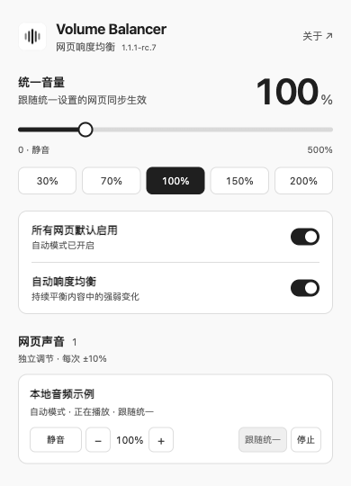

# Volume Balancer

[简体中文](README.md) · **English**

Automatically balance sound levels across web pages, with **0–500% volume** and **per-page controls**. Audio is processed locally. The interface supports English and Simplified Chinese.

[Download the latest version](https://github.com/UFOAlastor/volume-balancer/releases/latest)

## Install or update

Requires **Microsoft Edge 116+**. Install manually using the GitHub package below. This release does not indicate availability in the Edge Add-ons store.

1. Download the extension ZIP (the file whose name starts with `volume-balancer-`) from **Assets** on the [latest release page](https://github.com/UFOAlastor/volume-balancer/releases/latest) and extract it to a folder you intend to keep.
2. Open `edge://extensions/` and enable **Developer mode**.
3. Select **Load unpacked**, then choose the extracted folder containing `manifest.json`. If you downloaded the repository source instead, select its **extension** folder.
4. Pin **Volume Balancer**, refresh any existing media pages, and start playback.

**Updating:** Extract the new version into the existing installation folder, click **Reload** on the extensions page, and refresh your media pages. Global settings are preserved; per-page settings reset when the extension reloads or updates, or when the browser restarts.

## Everyday use

- Automatic loudness leveling is enabled by default, with **100%** volume on a fresh installation. You can turn leveling off and continue using volume controls.
- Adjust global volume with the slider or presets. Mute, adjust, stop, or resume processing for individual pages. Processing continues when you close the popup.
- On supported Bilibili, YouTube and other audio/video pages, normal playback starts automatic processing without opening the popup. The player's mute and zero-volume choices take priority.
- For other pages that need whole-tab processing, use the current-page capture controls. Turning off automatic mode does not stop an active whole-tab capture; stop it separately.

*This screenshot shows an earlier Chinese interface. The current layout may differ; an English interface is also available.*

## Compatibility and listening tips

Start at a comfortable volume and increase it gradually. Boost increases progressively above 200%; high gain may amplify background noise, reduce dynamics and introduce distortion. The actual increase depends on the source and peak limits. Volume may change when processing stops. If playback sounds wrong, refresh the page and play it again.

Cross-origin media, DRM, and website restrictions may limit processing. Some sources only support volume reduction; check the page's status in the popup. Peak protection applies only to sources that can be processed and does not guarantee safe system output or listening levels. Use the original player's controls on browser internal pages, extension pages, and local files.

The project has validation records for Edge 156. Other browsers and every website or playback configuration have not been verified; Windows, physical audio devices, and long-running sessions still need further validation.

## Privacy and license

Real-time audio, media state, and page titles are used for local sound controls and display. Settings are stored locally. Open **About** in the extension for the [privacy notice](extension/privacy.html) and full license information.

Based on [tyrantqiao/balanceVoice](https://github.com/tyrantqiao/balanceVoice), originally created by **qiao**. Distributed under the [MIT license](LICENSE), with [source attribution](NOTICE.txt) preserved.

Additional documentation in Chinese: [Usage guide](docs/USAGE.md) · [Compatibility](docs/COMPATIBILITY.md) · [Acknowledgements](docs/ACKNOWLEDGEMENTS.md).
