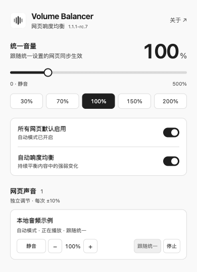

# Volume Balancer · 网页响度均衡

打开网页，自动平衡声音大小。支持 **0–500%** 音量、逐页调节。本机处理。

## 安装或更新

当前源码版本为 **1.1.2**。适用于 Microsoft Edge 116+，本版在 Edge 156 验证。

1. 下载并解压本仓库源码。
2. 打开 `edge://extensions/`，开启「开发人员模式」。
3. 点击「加载解压缩的扩展」，选择包含 `manifest.json` 的目录。使用源码时选择 **extension 文件夹**。
4. 在扩展菜单中固定 **Volume Balancer**，刷新已有音视频网页。

更新时保留安装目录，替换文件后点击「重新加载」，再刷新音视频网页。既有网页在刷新前可能无法继续处理；若声音异常，请刷新网页后重新播放。

## 使用

- 正常播放网页音视频，默认开启的「所有网页默认启用」和「自动响度均衡」会自动平衡强弱变化。
- 全新安装默认音量 **100%**，已有设置继续保留。可选 **30%、70%、100%、150%、200%** 快捷档，或用滑块调节 **0–500%**；键盘方向键按 1% 调整。
- 统一音量与开关会记住，重启 Edge 后沿用。单页音量与停止状态保留至扩展重载、更新或浏览器重启；选择「跟随统一」恢复统一音量。
- 「自动响度均衡」可单独关闭，关闭后保留音量调节和可用的峰值保护。
- 网页列表支持静音、每次 ±10%、独立音量、跟随统一、停止与恢复。关闭面板后继续生效。
- 整页接管入口位于「网页声音」上方的「当前网页 · 整页接管」卡片。自动模式开启时也能使用，无需关闭开关。

点击面板右上角「关于」查看隐私说明、来源和完整许可。

## 使用提示

- 在舒适音量下逐步调整。高增益可能放大底噪并压缩动态，实际增幅取决于音源和峰值上限；停止后由网页继续控制声音，音量可能变化或变大；若声音未正常恢复，请刷新网页后重新播放。
- 处理可用时会自动限制过高峰值，旧版保存的上限继续沿用，主面板无需设置。它针对单个可处理音源；系统混音与耳边音量仍需自行控制。部分受限音源仅支持调低音量，突发大声仍可能通过。详见「关于」和[兼容性说明](docs/COMPATIBILITY.md)。
- Bilibili 正常播放后，点击工具栏的 Volume Balancer 图标，面板会自动启用整页声音处理，无需再开额外开关。之后可调 0–500%，关闭面板仍继续生效；播放器自己的音量和静音保持不变。启用前或采集失败时，网页行会明确显示原声或未生效；失败可点击「接管当前网页声音」重试。
- 部分跨域媒体、受版权保护的内容或站点限制会影响处理；面板会显示可用状态。浏览器内部页、扩展页和本地文件请使用原播放器调节。网页合成声音可尝试整页接管。

## 隐私与许可

实时音频、媒体状态和网页标题用于本机声音控制与显示，设置保存在本机。完整数据用途与控制方式见[隐私说明](extension/privacy.html)。

基于 [tyrantqiao/balanceVoice](https://github.com/tyrantqiao/balanceVoice)，原作者 **qiao**。完整 [MIT 许可](LICENSE) 与[来源说明](NOTICE.txt) 随安装包提供。

## 来源与致谢

感谢原作者 qiao 的 [Balance Voice](https://github.com/tyrantqiao/balanceVoice)，以及音色与交互研究中实际查阅的 [EffeTune](https://github.com/Frieve-A/effetune)、[Umbra](https://github.com/skyjacc/Umbra)、[KoalaSound](https://github.com/Shik3i/KoalaSound)、[AutoEq](https://github.com/jaakkopasanen/AutoEq) 和 [Volume Control](https://github.com/Chaython/volumecontrol)。同类项目的查阅与致谢不表示采用其代码、提供相同功能或获得其背书。

[使用指引](docs/USAGE.md) · [完整致谢与参考资料](docs/ACKNOWLEDGEMENTS.md)
